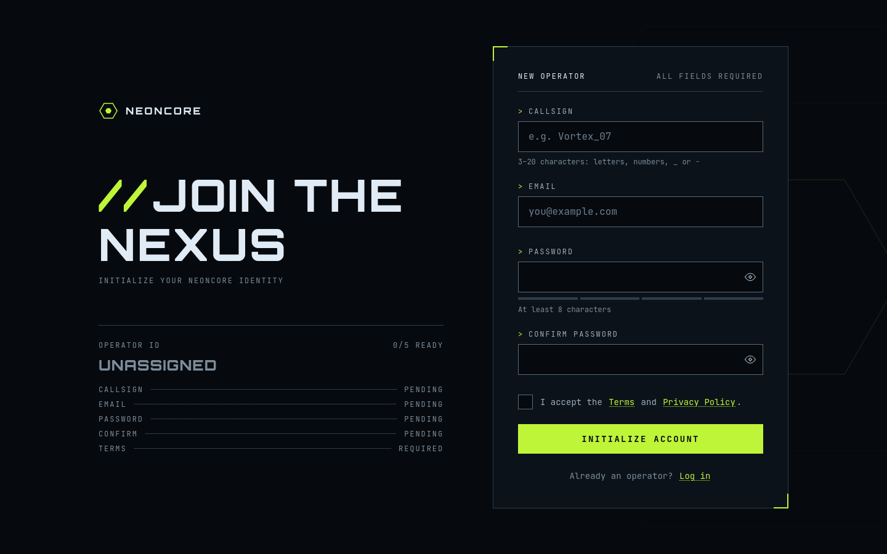
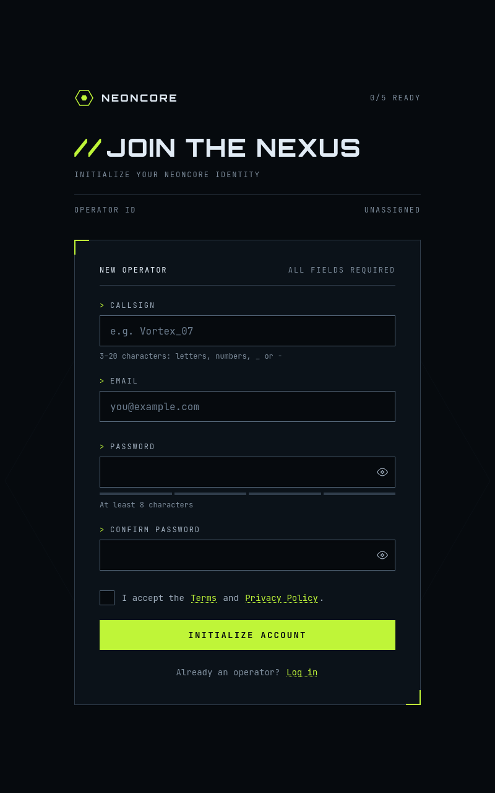
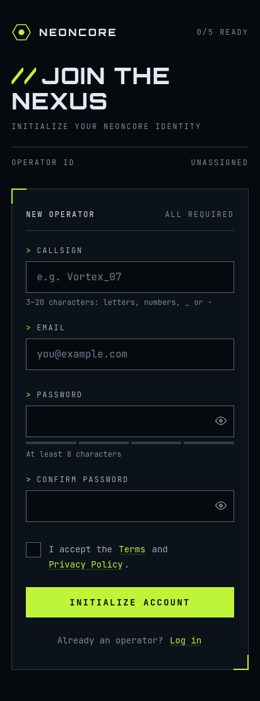

# Frontend Mentor - Gamer sign-up form solution

This is a solution to the [Gamer sign-up form challenge on Frontend Mentor](https://www.frontendmentor.io/challenges/gamer-sign-up-form). Frontend Mentor challenges help you improve your coding skills by building realistic projects.

## Table of contents

- [Overview](#overview)
  - [The challenge](#the-challenge)
  - [Screenshot](#screenshot)
  - [Links](#links)
- [My process](#my-process)
  - [Built with](#built-with)
  - [What I learned](#what-i-learned)
  - [Continued development](#continued-development)
  - [Useful resources](#useful-resources)
  - [AI Collaboration](#ai-collaboration)
- [Author](#author)
- [Acknowledgments](#acknowledgments)

**Note: Delete this note and update the table of contents based on what sections you keep.**

## Overview

### The challenge

Users should be able to:

- Fill in the form with a callsign, email, password, and password confirmation, and accept the terms
- Receive form validation messages if any field is missed or filled in incorrectly
- Show and hide each password with the eye button
- See a password strength meter update as they type
- See a loading state on the button while the form submits, then a success message
- Complete the form only using their keyboard
- Have inputs, hints, error messages, and the success message announced on their screen reader
- View the optimal layout for the interface depending on their device's screen size
- See hover and focus states for all interactive elements on the page

### Screenshot

|  |  |  |
| ------------------------------ | ----------------------------- | ----------------------------- |
| Desktop                        | Tablet                        | Mobile                        |

### Links

- Solution URL: [Add solution URL here](https://your-solution-url.com)
- Live Site URL: [Add live site URL here](https://your-live-site-url.com)

## My process

### Built with

- Vue 3 with `<script setup>` and TypeScript
- Vite 8 for the development server and production build
- Tailwind CSS 4 for styling and responsive layout
- Vee Validate and `@vee-validate/zod` for form state, touched fields, and validation messages
- Zod 4 for schema validation
- `check-password-strength` for the live strength meter
- GSAP for entrance, shake, scramble, and text animations, with reduced-motion handling
- No backend: a valid submit waits briefly with a timeout, then shows the success panel

### What I learned

- A field can be **invalid** without being **checked**. The form only shows a message after blur or submit, then re-checks on every keystroke once checked. I used `isFieldTouched`, `submitCount`, and a small `wasChecked()` helper to control that.
- Vee Validate's `defineField` gives attribute objects that have to reach the real input with `v-bind="inputAttrs"`. Without that, blur handling and `aria-invalid` never reach the DOM.
- Zod's object-level `.refine()` is skipped when other fields are invalid, so a password-confirmation check placed there did not run reliably. A field-level computed schema fixed that without disturbing the rest of the form.
- Trimming is a rule, not a habit: only the callsign should be trimmed. Eight spaces should count as an eight-character password.
- `aria-describedby` can point to a hidden element, so using `v-show` for the terms hint keeps the ID target in the DOM while still hiding it visually until submit.
- Moving focus to the success heading needs three pieces together: a template ref, `tabindex="-1"`, and `nextTick()` so Vue has rendered the new panel first.
- Keyboard-only and screen-reader testing catch things that looking at the page cannot. DevTools inspection of `id` and `aria-describedby` was especially useful.
- `npm run build` is not just a final step; it caught TypeScript mistakes early while I was changing validation logic.

### Continued development

- Route a mismatch-only submit through the same invalid-submit path as every other invalid field, so it announces the field count, focuses the first invalid field, and stays consistent with the rest of the form.
- Add automated tests for the Zod schemas and the validation-timing rules.
- Keep testing with keyboard only and with a screen reader in more than one browser.
- Extract the repeated field-wrapper and blur logic into a composable if more fields are added.
- Deploy the project and ask for a review in the Frontend Mentor community.

### AI Collaboration

I used an AI assistant as a mentor rather than as a way to skip the work. It helped me debug by explaining the reason behind validation timing, Vee Validate attribute forwarding, Zod refine behavior, ARIA description targets, and focus management. It usually gave hints or one small step at a time, then I tested the result in the browser and with `npm run build`.

I also pushed back when its static reading did not match what I heard with a screen reader. In those moments we re-checked the actual code together instead of assuming either side was right. That habit — test, inspect, then decide — became one of the most useful things I learned in this project. The final implementation and decisions are mine.

## Author

- Frontend Mentor - [@Yahyaball](https://www.frontendmentor.io/profile/Yahyaball)
